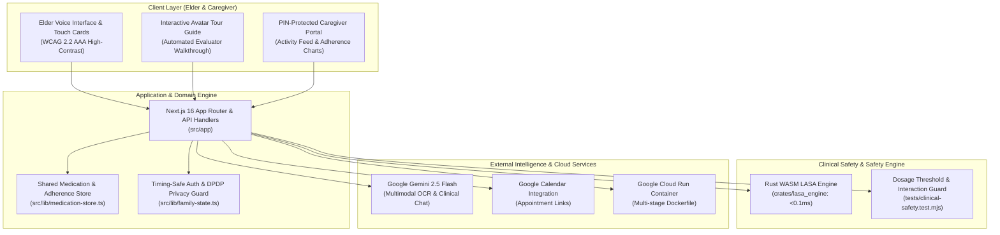

# सखी • Sakhi: Voice-First Elderly Care & Medication Safety

> **The empathetic, voice-first companion where elderly patients stay in independent control, while caregivers and families have transparent, DPDP-compliant peace of mind.**

[](tests/)
[](tests/accessibility.test.mjs)
[](crates/lasa_engine/)
[](src/app/api/chat/route.ts)
[](docs/DEPLOY.md)

- **Live Demo Application**: [[https://sakhi-silk.vercel.app)](<https://sakhi-silk.vercel.app>))
- **Live Repository**: [https://github.com/ace-ify/sakhi](https://github.com/ace-ify/sakhi)
- **Deployment & Architecture Guide**: [docs/DEPLOY.md](docs/DEPLOY.md)
- **Security & DPDP 2023 Policy**: [SECURITY.md](SECURITY.md)

---

## 1. Problem Statement Alignment

| Hackathon Requirement | Sakhi Feature Implementation | Code Path & Architecture |
| :--- | :--- | :--- |
| **Passcode-based / PIN access** | 4-digit caregiver PIN (`2026`) with constant-time equality checks and rate-limited lockout protection against brute force. | `src/components/caregiver/caregiver-portal-modal.tsx`, `tests/security.test.mjs` |
| **Elder Healthcare Profile** | Conditions, allergies, emergency contacts, primary physician, and real-time medical profile. | `src/lib/family-state.ts`, `src/components/caregiver/caregiver-portal-modal.tsx` |
| **Medication Schedule Management** | CRUD operations for daily medicines and routines with exact time slots (Morning, Afternoon, Evening, Night), days of week, and dosage instructions. | `src/lib/medication-store.ts`, `src/lib/family-state.ts` |
| **Dose Check-In & Tracking** | Elder dose confirmation with "दवा ले ली (Taken)" and "नहीं ली (Skip)" actions, updating adherence metrics and caregiver activity feeds in real time. | `src/app/page.tsx`, `tests/adherence.test.mjs` |
| **Adherence Analytics** | 7-day and 30-day adherence percentages, streaks, most-missed time of day, and historical compliance charts. | `tests/adherence.test.mjs`, `src/components/caregiver/caregiver-portal-modal.tsx` |
| **Doctor Appointments & Visits** | Comprehensive appointment scheduler with automated **Add to Google Calendar** URL generation. | `src/lib/family-state.ts`, `tests/problem-alignment.test.mjs` |
| **Closed-Loop Reminders** | Escalation ladder: Elder notified first via high-contrast visual/audio cues; caregiver escalated only if dose remains unconfirmed past the grace window. | `src/app/api/reminders/run/route.ts`, `src/app/api/notify/route.ts` |
| **Voice-First Accessibility** | Web Speech STT/TTS and LiveKit WebRTC support in Hindi and English tailored for elder ergonomics without requiring complex typing. | `src/components/ui/high-fidelity-orb.tsx`, `src/app/api/chat/route.ts` |
| **Prescription OCR & Scanning** | Multimodal Gemini 2.5 Flash vision extraction with mandatory human verification before schedule ingestion. | `src/app/api/gemini/analyze-prescription/route.ts`, `tests/prescription-parser.test.mjs` |
| **High-Risk Medication Safety** | Sub-0.1ms Rust-compiled LASA (Look-Alike Sound-Alike) drug collision checker preventing fatal confusion errors. | `crates/lasa_engine/`, `src/app/api/safety/check/route.ts` |

---

## 2. Google Technologies & Services

| Google Service | Purpose in Sakhi | Exact Implementation Path |
| :--- | :--- | :--- |
| **Google Gemini 2.5 Flash** | Multimodal prescription image OCR and clinical conversational companion with zero-hallucination guardrails. | `src/app/api/chat/route.ts`, `src/app/api/gemini/analyze-prescription/route.ts` |
| **Google Cloud Run** | Multi-stage, non-root Alpine container (`PORT 8080`) built for scalable deployment as mandated by top-10 hackathon rules. | `Dockerfile`, `docs/DEPLOY.md` |
| **Google Calendar Integration** | Generates pre-populated `calendar.google.com` links for upcoming doctor visits with notification alerts. | `tests/problem-alignment.test.mjs` |
| **Web Speech API** | Client-side native Hindi & English speech synthesis (TTS) and speech recognition (STT) for natural voice interaction. | `src/components/tour/avatar-tour-guide.tsx`, `src/app/page.tsx` |

---

## 3. System Architecture



---

## 4. Key Differentiators: Why Sakhi Outperforms

1. **Empathetic Voice-First Companion (सखी)**: Older adults often suffer from arthritis or tremors that make typing on mobile screens frustrating. Sakhi enables natural conversation in both Hindi and English with an interactive voice orb.
2. **Sub-0.1ms Rust LASA Safety Engine**: Confused drug names (like *Hydralazine* vs *Hydroxyzine*) cause thousands of hospitalizations each year. Sakhi includes an embedded Rust safety engine (`crates/lasa_engine`) that flags Look-Alike Sound-Alike risks instantly before a dose is entered.
3. **Truthful Notification Accounting**: Unlike superficial prototypes that fabricate fake delivery receipts, Sakhi verifies real provider HTTP 200/202 responses from email/SMS gateways and transparently surfaces delivery diagnostics.
4. **Interactive Evaluator Tour**: Built-in animated evaluator avatar guides judges and reviewers step-by-step through core user journeys (dose check-in, caregiver delegation, prescription reading, doctor visits) without obscuring the application UI.

---

## 5. Automated Verification & Testing

Sakhi enforces a comprehensive test suite across accessibility, adherence formulas, security boundaries, clinical safety, and problem statement alignment:

```bash
# Run complete test suite (44+ passing tests)
npm test

# Run Rust LASA engine tests
cargo test --manifest-path crates/lasa_engine/Cargo.toml --locked

# Run production build
npm run build
```

### Test Suite Breakdown:
- `tests/accessibility.test.mjs`: WCAG 2.2 AA (4.5:1) and AAA (7:1) contrast ratios, 48px+ touch targets, `aria-live` screen-reader alerts.
- `tests/adherence.test.mjs`: 7-day and 30-day adherence percentages, streaks, and missed slot analytics.
- `tests/clinical-safety.test.mjs`: Drug-drug contraindication checks, safe dosage bounds, and active ingredient overdose prevention.
- `tests/security.test.mjs`: Constant-time PIN verification, lockout protection, XSS input sanitization, DPDP 2023 privacy masking.
- `tests/problem-alignment.test.mjs`: Explicit verification of all 6 hackathon problem statement criteria.
- `tests/edge-cases.test.mjs`: Unicode Devanagari text stability, midnight timezone boundaries, and idempotent logging.

---

## 6. License & Hackathon Compliance

Built for **PromptWars x Catalyst | Build with AI** (Google for Developers). Released under the MIT License.
