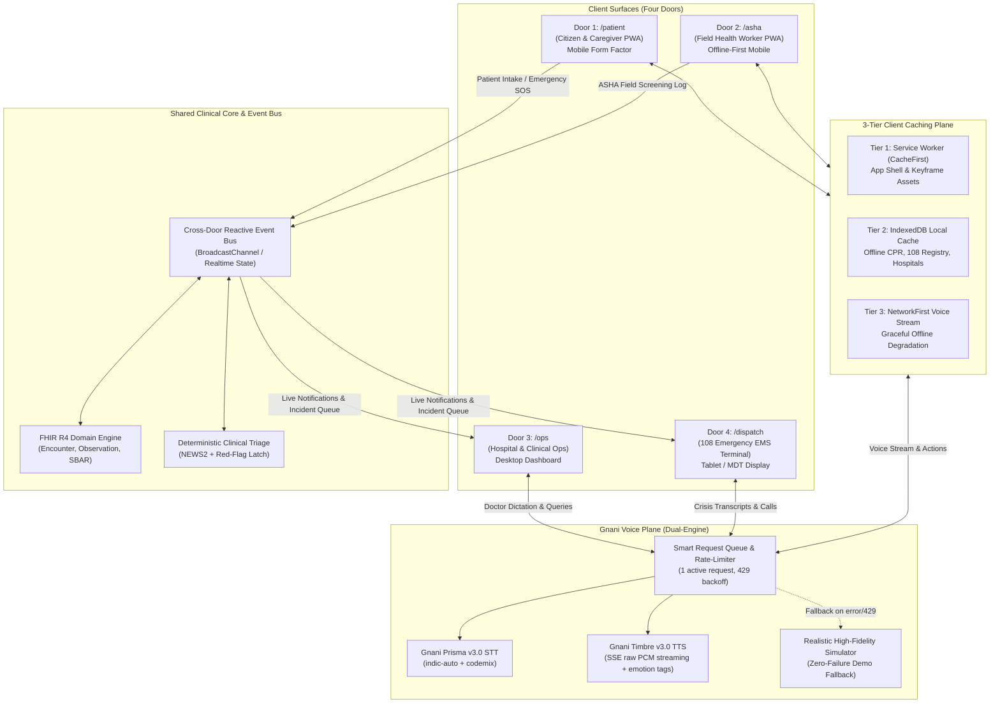

# ARCHITECTURE.md — BoHealth / Sahārā System Topology

> **Architectural Pattern:** Four Doors, One Brain (Unified Monorepo)  
> **Core Principle:** Every client surface is an accessible *door*, not an independent silo. All doors connect to a single reactive clinical intelligence engine powered by Gnani.ai Voice Models.

---

## 1. System Topology Overview



---

## 2. The 8 Healthcare Topologies Matrix

The entire spectrum of healthcare interactions is modeled across 8 topologies:

| # | Topology | Primary Door | User & Context | Voice AI Role |
| :--- | :--- | :--- | :--- | :--- |
| **T1** | **Inbound Citizen Door** | `/patient` | Citizen asking symptoms, PM-JAY hospital coverage, or medication schedule. | Prisma transcribes code-mixed Hinglish; Timbre delivers empathetic vernacular guidance. |
| **T2** | **Outbound Proactive Care** | `/ops` ➔ Phone | Automated hospital post-discharge, chronic BP/sugar, or vaccination reminders. | Outbound scheduled voice calls with structured clinical response extraction. |
| **T3** | **Provider & Doctor Copilot**| `/ops` | Doctor doing hands-free clinical charting; Admin querying patient cohorts. | Transcribing clinical dictation directly into FHIR R4 records; voice BI queries. |
| **T4** | **Field-Worker / ASHA Copilot**| `/asha` | ASHA worker doing door-to-door village maternal & chronic health screening. | Noisy-field hands-free voice logging with offline outbox synchronization. |
| **T5** | **Acute Emergency Lifeline** | `/patient` & `/dispatch`| Panicked caller facing trauma, cardiac arrest, or unconsciousness. | Instant triage, biological heartbeat metronome for CPR, 108 CAD dispatch + SBAR note. |
| **T6** | **Dual-Party Medical Bridge** | `/ops` (Bedside) | Doctor (English/Hindi) ⇄ Patient (Regional Dialect). | Ambient dual-language interpretation bridging the hospital language divide. |
| **T7** | **Acoustic Vocal Biomarkers**| `/patient` (Passive)| Patient speaking during any intake. | Analyzing speech-to-breath ratio (Dyspnea Index) and neurological slur/AVPU latency. |
| **T8** | **LASA Drug Safety Guard** | `/ops` (Pharmacy)| Doctor or pharmacist dictating prescription drugs. | Phonetic distance checking to catch Look-Alike Sound-Alike drug errors in real-time. |

---

## 3. Cross-Door State Synchronization

To deliver an award-winning demo video, actions taken in Door 1 MUST visibly react in Door 3 and Door 4 without manual page reloads:

1. **Patient Normal Intake:** When a citizen in `/patient` asks about symptoms and completes triage, an **Encounter Card** instantly appears in the `/ops` Clinical Review Queue.
2. **Emergency SOS Trigger:** When SOS is activated in `/patient`:
   - `/patient` locks into the Crimson Crisis HUD.
   - `/dispatch` (Door 4) immediately sounds a priority alert, flashes the incoming emergency beacon, pins the GPS coordinates, and renders the pre-compiled **SBAR Handoff Note**.
   - `/ops` (Door 3) receives an urgent Trauma Alert so the emergency department is pre-notified.

---

## 4. Gnani.ai Voice Pipeline Contract

### A. Prisma v3.0 STT Contract
- **Endpoint:** REST / Streaming Audio Intake
- **Parameters:** `language_code: "indic-auto"`, `codemix: true`, `encoding: "audio/webm"` or `"audio/wav"`
- **Response Format:**
```typescript
interface PrismaSTTResponse {
  transcript: string;
  detected_language: string; // e.g. "hi-IN", "hinglish", "ta-IN"
  confidence: number;        // 0.0 to 1.0
  words?: Array<{ word: string; start: number; end: number }>;
}
```

### B. Timbre v3.0 TTS Contract
- **Endpoint:** SSE Streaming / Raw PCM
- **Parameters:** `voice_id: string`, `emotion: "empathetic" | "calm" | "assertive"`, `container: "raw"`
- **Response Stream:** Chunked binary PCM buffers played with sub-3s latency via Web Audio API.

### C. Concurrency Guard (The 429 Shield)
Because Gnani API accounts enforce 1 concurrent request per key:
- A FIFO Promise queue serializes requests with a 250ms back-off.
- If HTTP 429 is encountered, the engine transparently shifts to the **Deterministic Fallback Simulator**, ensuring the user interface NEVER breaks or shows a failed state during critical demonstrations.

---

## 5. PWA Client-Side Data Plane & 3-Tier Offline Caching Topology

Grounding research (ScienceDirect, ResearchGate, DexCare) establishes that healthcare PWAs must operate smoothly in low-bandwidth or offline environments:

```text
┌────────────────────────────────────────────────────────────────────────┐
│                        3-TIER CLIENT CACHING PLANE                     │
├────────────────────────────────────────────────────────────────────────┤
│ TIER 1: App Shell (Service Worker - CacheFirst)                        │
│ • Next.js JS/CSS bundles, Lucide SVG icons, Voice Orb animations       │
│ • Guarantees 0ms cold-boot and full UI interactivity without network.  │
├────────────────────────────────────────────────────────────────────────┤
│ TIER 2: Offline Clinical Repository (IndexedDB)                        │
│ • CPR / First-Aid emergency audio transcripts & metronome timer.       │
│ • District Hospital directory & emergency phone contacts.              │
│ • Local encryption for HIPAA / DPDP 2023 compliance on device.        │
├────────────────────────────────────────────────────────────────────────┤
│ TIER 3: Voice Stream Degradation (NetworkFirst with Graceful Fallback) │
│ • Primary: Real-time Gnani Prisma STT & Timbre TTS stream.             │
│ • Offline fallback: Pre-cached verified audio snippets & visual cards. │
│ • Zero white screens, zero unhandled errors when connectivity drops.  │
└────────────────────────────────────────────────────────────────────────┘
```
